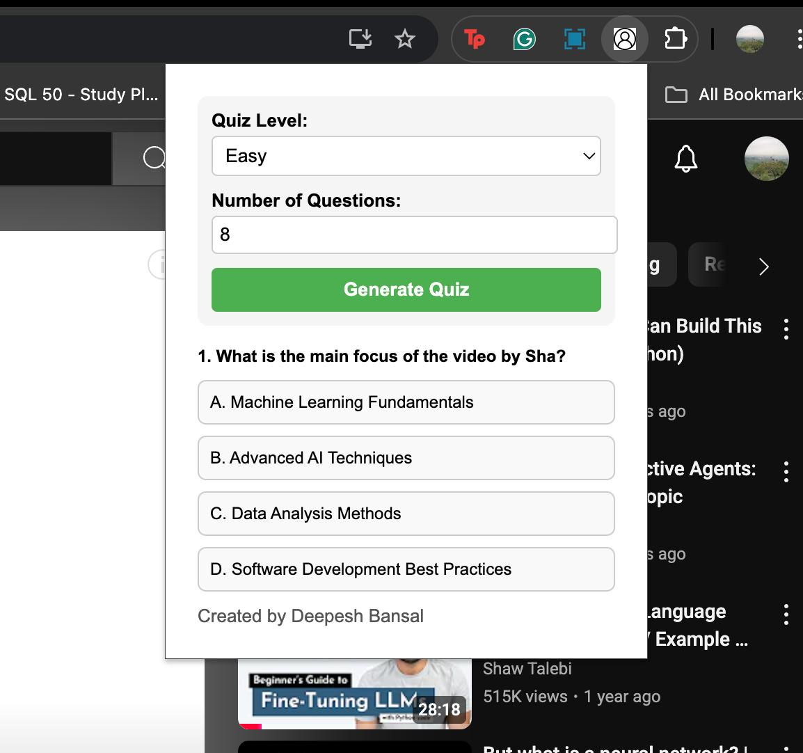

# InstaEval 


> As the way we consume knowledge changes, we should change the way we evaluate ourselves.

**InstaEval** - Transform any YouTube video, article, or webpage into an interactive quiz instantly. Test your understanding in real-time while consuming content.

##  Features

- **YouTube Video Quizzes**: Generate quizzes from any YouTube video with captions
- **Web Content Extraction**: Create quizzes from articles, blogs, and web pages
- **Customizable Difficulty**: Choose between Easy, Medium, or Hard quiz levels
- **Flexible Question Count**: Generate 5-20 questions based on your preference
- **Instant Feedback**: Get immediate feedback on your answers with visual indicators
- **Locally Hosted**: Run the Flask server and browser extension on your machine
- **Chrome Extension**: Seamlessly integrates with your browsing experience

## Installation

### Prerequisites
- Python 3.9+
- Chrome Browser
- OpenAI API Key

### Step 1: Clone the Repository
```bash
git clone https://github.com/hitmannoob/InstaEval.git
cd InstaEval
```

### Step 2: Install Python Dependencies
```bash
python -m venv .venv
source .venv/bin/activate  # Windows PowerShell: .venv\Scripts\Activate.ps1
python -m pip install -r requirements.txt
```

### Step 3: Set Your OpenAI API Key
The server reads the key from the `OPENAI_API_KEY` environment variable. Do not
put the key in `app.py` or commit it to the repository.

macOS/Linux:
```bash
export OPENAI_API_KEY="your-openai-api-key-here"
```

Windows PowerShell:
```powershell
$env:OPENAI_API_KEY = "your-openai-api-key-here"
```

### Step 4: Start the Flask Server
```bash
python app.py
```
The server will start on `http://127.0.0.1:5000`

### Step 5: Load the Chrome Extension
1. Open Chrome and navigate to `chrome://extensions/`
2. Enable "Developer mode" (toggle in top right)
3. Click "Load unpacked"
4. Select the folder containing the extension files (manifest.json, popup.html, etc.)
5. The InstaEval icon will appear in your extensions bar

## How to Use

1. **Navigate to Content**: Open any YouTube video or article you want to study
2. **Click the Extension**: Click the InstaEval icon in your browser
3. **Configure Your Quiz**:
   - Select difficulty level (Easy/Medium/Hard)
   - Choose number of questions (5-20)
4. **Generate Quiz**: Click "Generate Quiz" button
5. **Test Yourself**: Answer questions and get instant feedback
   - ✅ Green = Correct answer
   - ❌ Red = Wrong answer

## Supported Content Types

- **YouTube Videos** (with captions enabled)
- **Blog Posts & Articles**
- **Google Docs**
- **News Websites**
- **Educational Content**
- **Any text-heavy webpage**

## Privacy

The Flask server and browser extension run on your machine. Quiz generation
sends selected page text or an extracted YouTube transcript to the configured
OpenAI API. Review the provider's data policy and keep your API key private.
This project does not add tracking or analytics.

## Configuration

### Adjusting Quiz Parameters
- **Easy Mode**: Basic recall and comprehension questions
- **Medium Mode**: Understanding and application of concepts
- **Hard Mode**: Deep analysis and critical thinking questions

### API Limits
- Maximum 30,000 characters per content
- 5-20 questions per quiz
- Supports GPT-4o-mini model

## Troubleshooting

**Quiz not generating?**
- Ensure Flask server is running (`python app.py`)
- Set `OPENAI_API_KEY` in the same terminal before starting the server
- Check if the website has sufficient text content
- Verify your OpenAI API key is valid and has available API access

**YouTube transcript not working?**
- Video must have captions enabled
- Some restricted or private videos may not work

**Extension not loading?**
- Refresh the page after installing
- Check Chrome extension permissions


##  Author

Created by Deepesh Bansal

---

**Transform passive consumption into active learning with InstaEval!** 
